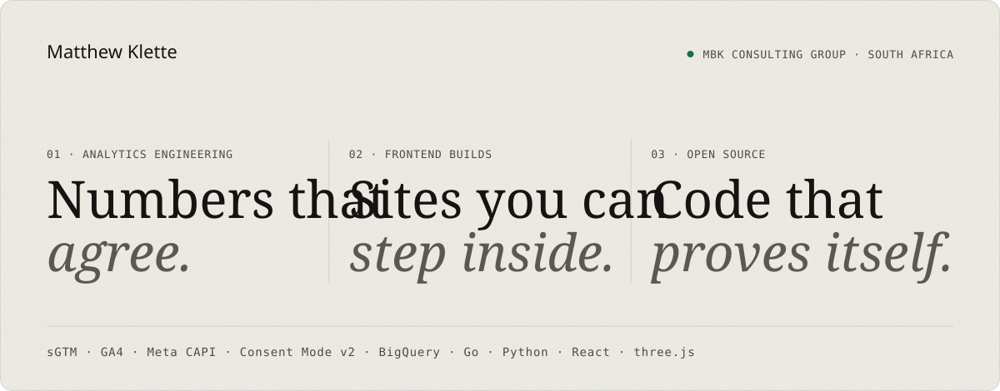
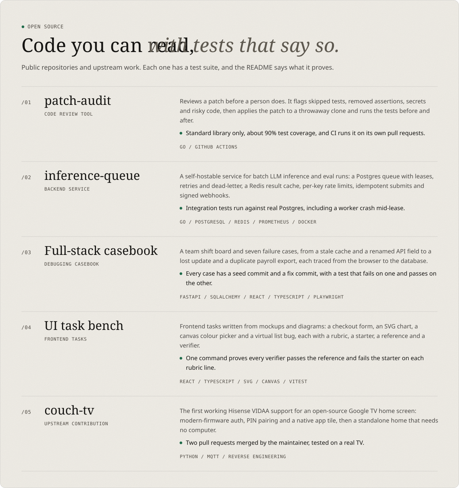
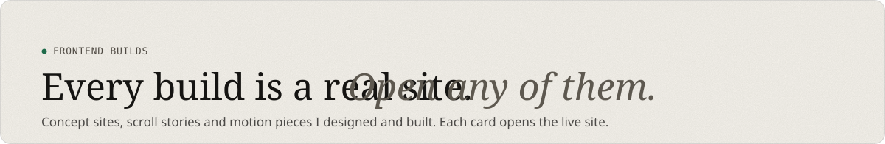
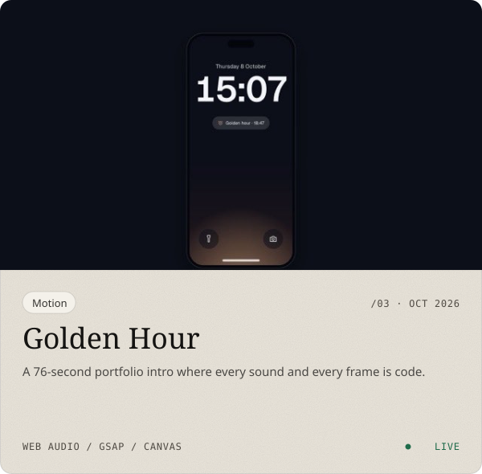
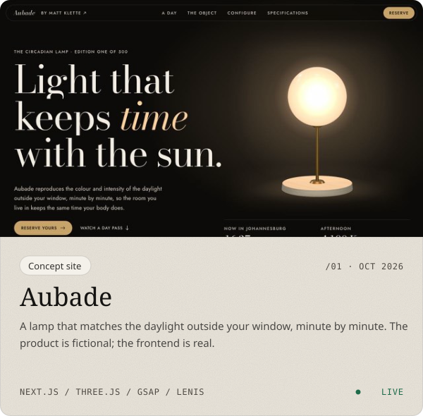
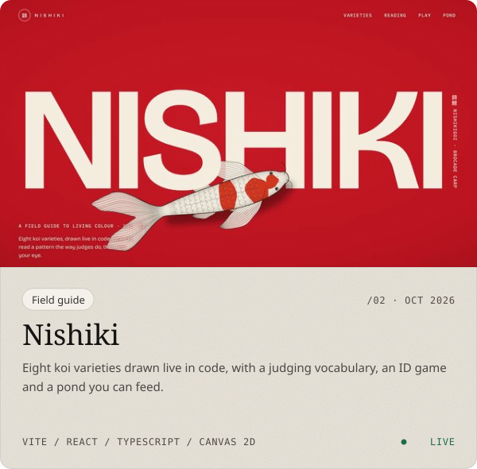
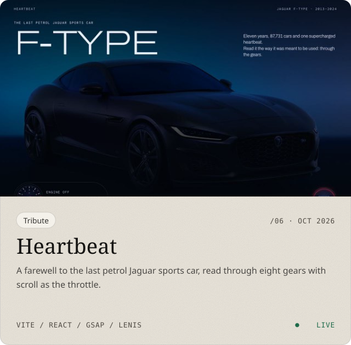
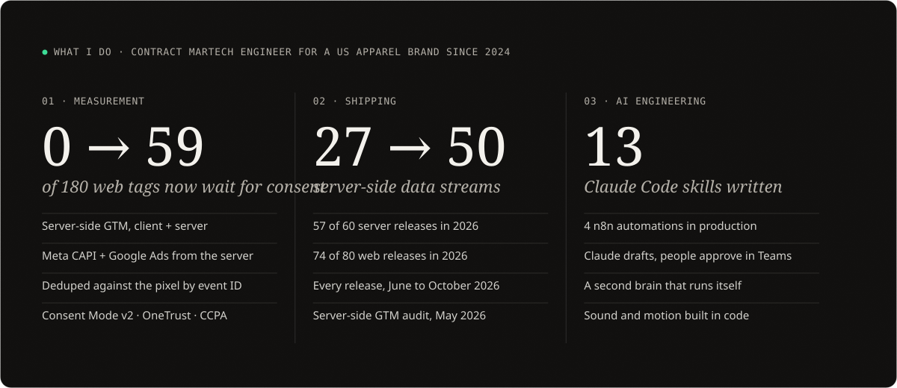
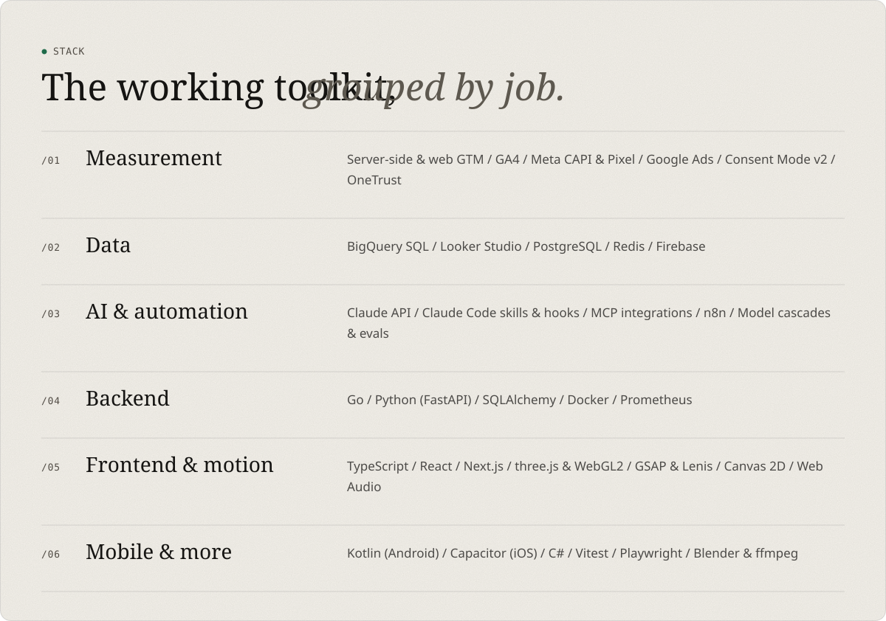

<a href="https://github.com/Matthew-Klette/patch-audit"><b>patch-audit</b></a> · Go
&nbsp;&nbsp;|&nbsp;&nbsp;
<a href="https://github.com/Matthew-Klette/inference-queue"><b>inference-queue</b></a> · Go, Postgres, Redis
&nbsp;&nbsp;|&nbsp;&nbsp;
<a href="https://github.com/Matthew-Klette/fullstack-casebook"><b>fullstack-casebook</b></a> · FastAPI, React
&nbsp;&nbsp;|&nbsp;&nbsp;
<a href="https://github.com/Matthew-Klette/ui-task-bench"><b>ui-task-bench</b></a> · React, SVG, Canvas
 
Upstream: <a href="https://github.com/Seagey/couch-tv/pull/128">couch-tv #128</a> · <a href="https://github.com/Seagey/couch-tv/pull/141">#141</a>
&nbsp;&nbsp;|&nbsp;&nbsp;
Also: <a href="https://github.com/Matthew-Klette/gs-code">gs-code</a> · <a href="https://github.com/Matthew-Klette/synthetic-crowd">synthetic-crowd</a>

<a href="https://mbkconsultinggroup-portfolio.vercel.app">Portfolio</a> ·
<a href="https://www.linkedin.com/in/matthewklette">LinkedIn</a> ·
<a href="https://golden-hour-smoky.vercel.app">Portfolio intro</a>

